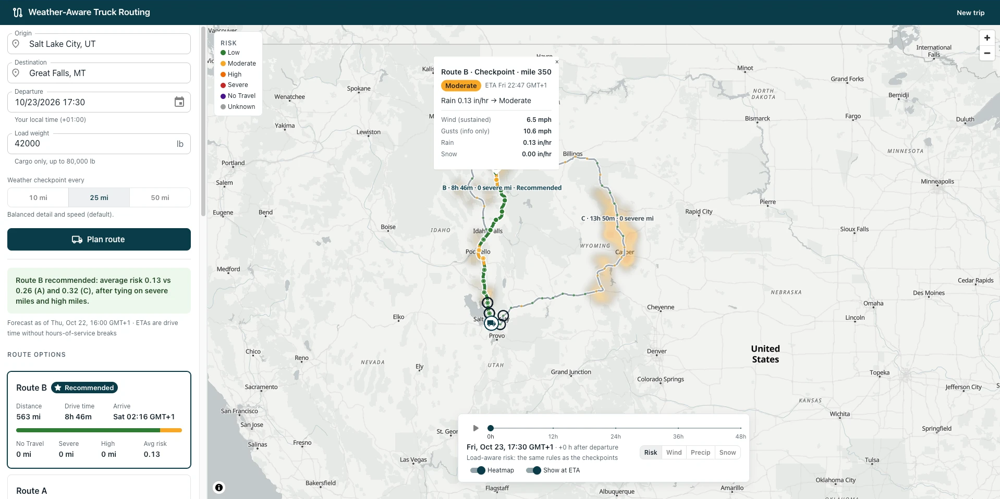

# Weather-Aware Truck Routing

A React + Django app that helps a truck driver choose the safest of 3 routes, using the forecast **at the truck's ETA** at each checkpoint, the **load weight**, and **travel time**.

**Live app:** [spotter-truck-routing-omega.vercel.app](https://spotter-truck-routing-omega.vercel.app) · **API:** [p01--spotter-truck-routing--8zfwjn862f7f.code.run/api/v1/health](https://p01--spotter-truck-routing--8zfwjn862f7f.code.run/api/v1/health) · **Walkthrough:** [Loom video](https://www.loom.com/share/c97f49ffb56743faa0e87bc17e4e14b4)



## What it does

1. You enter an origin and destination, a departure date/time, the load weight (lb), and a checkpoint interval of **10 / 25 / 50 mi** (default 25).
2. The backend gets **3 truck routes** from TomTom. It places checkpoints every N miles on every route (the same N for all three), computes the truck's ETA at each checkpoint, and reads the Open-Meteo forecast **for that place at that hour**.
3. Each checkpoint is classified with the brief's wind / rain / snow table and its load rules. The route **recommendation** follows the brief's order: fewest Severe miles → fewest High miles → lowest average risk → shortest travel time. The reason is written out, e.g. *"Route B recommended: 0 severe miles vs 18 (A) and 31 (C)."*
4. The map shows all routes, risk-coloured checkpoints with ETAs and reasons, and a summary on each route. A **weather heatmap over the trip corridor** has a **0–48 h slider**. The slider only swaps paint expressions on data that is already loaded, so it makes no network calls while scrubbing. Measured on the production build: 60 fps (16.7 ms average frame, 17.3 ms p95).

Plans are saved, so `/plans/:id` is a shareable link.

## Run it locally

Requirements: Docker. Put your TomTom key in `backend/.env` (see `backend/.env.example`):

```bash
docker compose up --build
```

- App: http://localhost:5173
- API: http://localhost:8000/api/v1/health
`
`docker compose` starts Postgres, Redis, the API and the Vite dev server. To work without live APIs, use the offline providers: `WEATHER_PROVIDER=fixture` replays a recorded real Open-Meteo snapshot, and `ROUTING_PROVIDER=fixture` gives synthetic routes. For example:

```bash
WEATHER_PROVIDER=fixture docker compose up -d api
```

### Tests and checks

```bash
cd backend && uv run pytest && uv run ruff check routing config && uv run mypy
```

```bash
cd frontend && npx vitest run && npx tsc -b --noEmit && npx eslint .
```

The tests never call live APIs. They cover every boundary of the risk table (24.99 / 25 mph, 1.00 / 1.0001 in/hr, 30,000 / 30,001 lb…), each ranking tie-breaker, checkpoint placement and ETAs, weather-at-ETA alignment, the "fewer than 3 routes" fill, the API error contract, and the heatmap colour expressions (evaluated with MapLibre's own expression engine).

## Architecture

```
React 18 + TS + MUI + MapLibre (react-map-gl) + TanStack Query      ── Vercel
        │  REST/JSON  /api/v1/…
Django + DRF modular monolith                                         ── Northflank
  api/        serializers, thin views, one error envelope
  services/   plan_trip, heatmap, caching, route fill
  domain/     risk, checkpoints, weather_at_eta, ranking, corridor   ← pure, fully tested
  providers/  tomtom, osrm, openmeteo, nominatim, fixture            ← vendor JSON stops here
Postgres (saved plans)   Redis (geocode 30 d · routes 10 min · weather 60 min · heatmap 10 min)
```

| Endpoint | Purpose |
|---|---|
| `POST /api/v1/plans` | Plan a trip: 3 routes, checkpoints, risk, recommendation (`201` + `Location`) |
| `GET /api/v1/plans/{id}` | Reload a saved plan |
| `GET /api/v1/plans/{id}/heatmap` | Corridor grid, hours 0–48 after departure, column-shaped |
| `GET /api/v1/geocode?q=` | Autocomplete proxy (keeps the TomTom key server-side) |
| `GET /api/v1/health` | Liveness and warm-up |

Every error has the same shape: `{"error": {"code", "message", "field", "request_id", "retryable"}}`. Full design: [docs/DESIGN.md](docs/DESIGN.md) and [docs/TECHNICAL_DESIGN.md](docs/TECHNICAL_DESIGN.md).

## Decisions and assumptions

1. The user picks the sampling interval: 10, 25 or 50 miles (default 25). The same interval applies to all 3 routes, and the single recommendation is based on it. 10 mi catches small storms (~7.5 mi wide) but needs more lookups; 50 mi is faster but can miss them.
2. Checkpoints include the origin and the destination. Each checkpoint owns the miles nearest to it, so a route's checkpoint miles add up exactly to its length.
3. Where the brief's ranges touch (e.g. rain 0.10–0.25 and 0.25–0.50), the lower bound is inclusive. No Travel follows the brief exactly: wind ≥ 55 mph, rain > 1.00 in/hr, snow > 3.0 in/hr.
4. Wind = sustained 10 m wind speed. Gusts are shown, not scored.
5. Load rules only raise the wind level, never lower it. The checkpoint level is the max of wind, rain and snow.
6. No Travel miles act as a gate above "fewest Severe miles". Next comes fewest miles without a forecast, because a route that can't be checked never beats one that can (a missing forecast is never treated as Low).
7. Average risk = distance-weighted mean of the level index 0–4 over miles with a known forecast.
8. Wind at an ETA is interpolated between hours. Rain and snow use the hour-ending value for the hour the truck is in (label `floor(ETA) + 1 h`). This equals `ceil` for every time except one exactly on the hour, where it reads the hour being driven rather than the hour before departure.
9. Rain rate = Open-Meteo `rain + showers`, because thunderstorm (convective) rain is reported in `showers`. Snowfall is new snow per hour, already the in/hr rate the table needs.
10. ETAs are drive-time ETAs from TomTom's truck profile, using historic speeds for the departure day and time (`traffic=false`: live traffic only describes "now"). They do not include hours-of-service breaks. TomTom routes on gross weight, so it receives the load plus 35,000 lb (tractor + empty trailer); the risk rules use the load exactly as entered.
11. Heatmap hours are relative to departure (hour 0 = departure). It uses the same load-aware risk rules as the checkpoints. The slider label always shows the absolute date and time.
12. A forecast beyond the provider's range is `UNKNOWN` (grey), never assumed Low.
13. If TomTom returns fewer than 3 routes, or takes longer than 8 s, more options come from routes through a via point either side of the midpoint. Near-duplicates (> 90 % shared geometry) are dropped, and a route is never invented.

## Providers

| Need | Provider | Fallback |
|---|---|---|
| Truck routing | TomTom Calculate Route (`travelMode=truck`, `vehicleWeight`, `departAt`, 2 alternatives) | OSRM public demo (no truck profile) |
| Geocoding | TomTom Search | Nominatim (1 request/s) |
| Weather | Open-Meteo hourly forecast, many locations per request | Recorded snapshot (`WEATHER_PROVIDER=fixture`) |
| Map | MapLibre GL + OpenFreeMap tiles | – |

## Environment variables

| Variable | Where | Notes |
|---|---|---|
| `TOMTOM_API_KEY` | API | Required for TomTom routing/geocoding |
| `DJANGO_SECRET_KEY` | API | Required in production |
| `DATABASE_URL` | API | Postgres (Neon in production; add `?sslmode=require`) |
| `REDIS_URL` | API | Redis (Upstash in production, `rediss://…`); in-memory cache if unset |
| `ALLOWED_HOSTS`, `CORS_ALLOWED_ORIGINS` | API | Northflank host (`*.code.run`) / Vercel URL |
| `ROUTING_PROVIDER`, `WEATHER_PROVIDER` | API | Optional: `tomtom`/`openmeteo` by default; `osrm` or `fixture` to switch |
| `VITE_API_URL` | Web | API origin in production (empty in dev: Vite proxies `/api`) |
| `VITE_MAP_STYLE_URL` | Web | Optional map style (OpenFreeMap Positron by default) |

## Deploying

Live setup: the **API on Northflank** (free Developer Sandbox, always on), the **frontend on Vercel**, **Postgres on Neon** and **Redis on Upstash**. CI (`.github/workflows/ci.yml`) runs every check above on each push and pull request. One-time setup:

1. **Database and cache:** create a free Neon Postgres and an Upstash Redis in a US region. Use Neon's direct connection string with `?sslmode=require`. For Upstash, take the URL from its `redis-cli` command and change `redis://` to `rediss://` (TLS).
2. **Northflank API:** create a project on Northflank Cloud (US - Central) and connect GitHub. Then **Create new → Service → Combined service** from this repo, branch `main`:
   - **Build:** Dockerfile, **build context** `/backend`, **Dockerfile location** `/backend/Dockerfile` (an absolute path from the repo root).
   - **Networking:** port `8080`, HTTP, publicly exposed.
   - **Health check:** none, or TCP on 8080. Not HTTP: Northflank's HTTP probe sends the container IP as the host, which Django rejects.
   - **Runtime variables:** `PORT=8080`, `DJANGO_SECRET_KEY` (a long random string), `DATABASE_URL`, `REDIS_URL`, `TOMTOM_API_KEY`, `ALLOWED_HOSTS` (the service's `*.code.run` host) and `CORS_ALLOWED_ORIGINS` (the Vercel URL, `https`, no trailing slash).
   - Sandbox needs a card for account verification after the first hour; you are not charged on the free plan.
3. **Frontend:** import the repo on Vercel with root directory `frontend` and set `VITE_API_URL` to the API URL (no trailing slash). Vercel may warn that `VITE_` values are public; that is intended, because the browser has to know the API address. `vercel.json` rewrites every path to the SPA, so `/plans/:id` links work on refresh.
4. **Check:** `curl https://p01--spotter-truck-routing--8zfwjn862f7f.code.run/api/v1/health` returns `{"status": "ok"}`. Then plan a trip on the live app.

Migrations run when the container starts (one instance). The app calls `/api/v1/health` when it loads, which is harmless on an always-on service.

## Known limits

- TomTom's 3-route call on long truck trips can take several seconds. Past 8 s the app falls back to the primary route plus via-point routes (decision 13). Repeat plans within 10 minutes come from the cache.
- The corridor grid is capped at 400 points to protect the free weather quota. Long trips use a coarser grid (up to 0.5° for ~1,400 miles).
- Free tiers: Open-Meteo counts each location as a call, and TomTom allows ~2,500 requests/day. Caching per map cell and per route keeps repeat plans close to free.
- The brief's load rules raise risk for **heavier** loads. In real crosswinds (e.g. Wyoming closures) **lighter**, high-profile trucks are the ones at risk. The app implements the brief's rules as written.

## Next steps

- Hours-of-service breaks in ETAs: a 30-minute break after 8 h of driving and a 10 h reset after 11 h.
- Gust-based rules and real-world crosswind rules for light, high-profile trucks.
- A departure-time optimiser: scan departures over the next 48 h and suggest the safest window.

## Out of scope

Auth and user accounts, a saved-trip history UI, real-time re-routing, traffic incidents, road closures, bridge heights, and building a routing engine.
